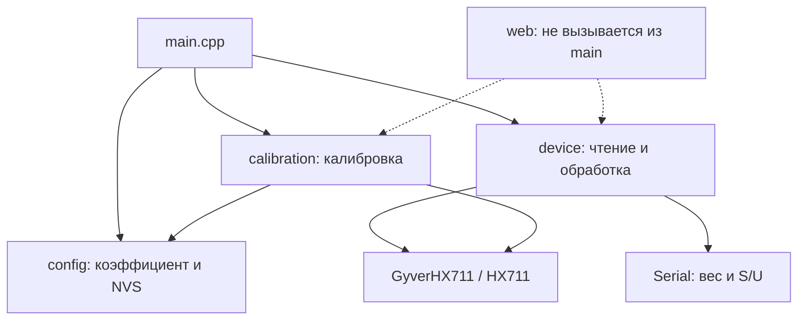

# Анализ прошивки Vesy_TMX

**Исторический анализ исходной версии до реализации USB-протокола v1.** Найденные ниже проблемы исправлялись в последующей доработке; активный код и структура изменились, web/calibration удалены. Актуальные команды описаны в [спецификации](DEBUG_COMMANDS_GUIDE_RU.md), требования к отдельно разрабатываемому приложению — в [текстовой инструкции](CLIENT_APP_INSTRUCTIONS_RU.txt).

Дата анализа: 13 октября 2026 года. Цель следующего этапа — управление весами отладочными командами через существующий USB COM-порт.

Проанализированы все прикладные исходники, конфигурация PlatformIO, README и установленная библиотека GyverHX711. Код прошивки в рамках анализа не изменён. Предлагаемый протокол и порядок реализации находятся в [инструкции](DEBUG_COMMANDS_GUIDE_RU.md).

## 1. Результат и границы проверки

Проект представляет собой небольшую Arduino-прошивку ESP32 с HX711. В основном окружении `esp32_usb` она читает датчик, переводит отсчёты в граммы, фильтрует их, автоматически тарирует весы и передаёт строки веса. Приём USB-команд отсутствует. Тарирование и калибровка как внутренние операции уже существуют, но их нельзя безопасно подключить к новому парсеру без изменения управления измерениями.

Проверенные сборки:

| Окружение | Результат | RAM | Flash | Что подтверждено |
|---|---|---:|---:|---|
| `esp32_usb` | SUCCESS | 21 688 / 327 680 байт | 283 013 / 1 310 720 байт | Основное USB-окружение собирается; проверка использовала существующий кэш сборки |
| `esp32_ota` | SUCCESS | 26 536 / 327 680 байт | 417 217 / 1 310 720 байт | В том числе компилируется `web.cpp`; выполнялись компиляция и линковка |

Использованные команды:

```powershell
& 'C:\Users\winda\.platformio\penv\Scripts\platformio.exe' run -e esp32_usb
& 'C:\Users\winda\.platformio\penv\Scripts\platformio.exe' run -e esp32_ota
```

Локально разрешены версии: Espressif 32 **7.0.1**, Arduino ESP32 **2.0.17** — пакет `3.20017.241212+sha.dcc1105b`, GyverHX711 **1.2.1**, встроенная Preferences **2.0.0**, toolchain GCC **8.4.0**. В `platformio.ini` версии платформы и GyverHX711 не закреплены.

Проверка не включала прошивку платы, открытие COM4, отправку команд на устройство, проверку физических подключений или измерение точности. Успешная сборка OTA не подтверждает доступность OTA: `main.cpp` не запускает сетевые функции. В `test/` есть только шаблонный README, автоматических тестов проекта нет. Численные примеры ниже проверены отдельной моделью формул; это не испытания на ESP32.

## 2. Карта проекта

| Файл | Ответственность и функции | Состояние |
|---|---|---|
| `src/main.cpp` | `setup()`, `loop()`, `outputWeightLine()`; выбор обычного режима или калибровки, Serial TX | Центральный цикл; отсутствуют Serial RX и диспетчер команд |
| `src/config.h` | Пины, параметры фильтра/пустоты/стабильности, объявление коэффициента и функций NVS | Параметры, кроме коэффициента, задаются при компиляции |
| `src/config.cpp` | `loadCalibrationFactor()`, `saveCalibrationFactor()` | Один коэффициент в NVS, результат операций не возвращается |
| `src/device/device.h` | Публичный `sensor`, измерительный цикл и три getter-функции | Не предоставляет управляемые операции tare/set factor/reset |
| `src/device/device.cpp` | Чтение HX711, EMA-фильтр, автотара, окно стабильности | Состояние измерения распределено по глобальным переменным |
| `src/calibration/calibration.h` | Запуск/обслуживание калибровки и getter-функции | Нет отмены, отдельного признака успеха или этапов |
| `src/calibration/calibration.cpp` | Ожидание установки груза, усреднение, вычисление и сохранение коэффициента | Запуск блокирует цикл; результат сразу применяется и сохраняется |
| `src/web/web.h` | `webSetup()`, `webLoop()`, `webLog()` | Не используется из `main.cpp` |
| `src/web/web.cpp` | HTML, HTTP status/log/calibrate, WiFi, mDNS, ArduinoOTA | Исключён из USB; в OTA компилируется, но не обслуживается |
| `platformio.ini` | Сборка, порты, библиотеки, фильтры исходников | Основное окружение `esp32_usb`, порт COM4 |
| `README.md` | Описание аппаратуры и прежнего пользовательского поведения | Существенно расходится с текущей прошивкой |
| `.vscode/*` | Настройки IDE, include paths, запуск отладчика | Привязаны к локальному пути и `esp32_usb`; не задают логику весов |
| `include/README`, `lib/README`, `test/README` | Шаблонные инструкции PlatformIO | Дополнительной прикладной логики нет |

Связи модулей:



Сейчас разделение чтения между `device` и `calibration` работает благодаря исключающей ветке в `loop()`. При добавлении команд нужно сохранить одного владельца чтения: два вызова `sensor.read()` из разных обработчиков не должны конкурировать за один отсчёт.

## 3. Текущее выполнение

### Запуск

1. Глобальный объект `GyverHX711 sensor` создаётся с GPIO14, GPIO27, каналом A и усилением 128.
2. `setup()` открывает Serial на 115200 и ждёт 500 мс.
3. Из namespace `vesy`, ключа `cal_factor` восстанавливается `calibration_factor`. Если ключа нет или namespace не открылся, остаётся значение из прошивки: приблизительно `-118.217292`.
4. `deviceSetup()` вызывает `sensor.tare()`, запоминает время и очищает только счётчики окна стабильности.
5. При `RUN_CALIBRATION_AT_BOOT` начинается калибровка с эталоном 275 г. По умолчанию этот флаг выключен.

Стартовая тара принимает имеющуюся нагрузку за ноль. Если устройство включено с грузом, показываться будет изменение относительно этого груза. Тара не хранится в NVS.

### Обычное измерение

`deviceLoop()` обрабатывает отсчёт только при `sensor.available()`:

```text
adc_absolute = исходный знаковый отсчёт HX711
offset       = внутреннее смещение GyverHX711
rawData      = adc_absolute + offset
rawWeight    = rawData / calibration_factor
filtered     = 0.7 * previous_filtered + 0.3 * rawWeight
empty        = abs(filtered) < 10 г
outputWeight = empty ? 0 : filtered
```

Таким образом, имя `rawData` в коде обозначает уже смещённый отсчёт, а `rawWeight` — нефильтрованный вес в граммах. Коэффициент имеет размерность **отсчётов АЦП на грамм**. Он является делителем. Отрицательный коэффициент допустим и соответствует полярности сигнала датчика.

После фильтра проверяется переход в состояние «пусто». При таком переходе сразу выполняется тара. Пока весы считаются пустыми, тара повторяется раз в 10 секунд. Затем отфильтрованный вес добавляется в кольцевой буфер из восьми значений.

`isStable()` возвращает true, если окно заполнено и `max - min < 1 г`. Проверяется окно **отфильтрованных**, а не исходных значений. В `config.h` комментарий про последние отсчёты HX711 требует этого уточнения.

Раз в 100 мс `main.cpp` выдаёт, например:

```text
123.45 S
0.00 U
```

Разделитель — пробел, десятичный разделитель — точка, окончание строки — LF. `S` означает маленький разброс в накопленном окне, `U` — незаполненное окно или больший разброс. Признаков ошибки/свежести в строке нет.

Расписание вывода не связано с появлением нового измерения: возможны повторные строки одного отсчёта. Если TX не вмещает строку, она пропускается. Поэтому 10 Гц — номинальная частота отправки, а не гарантия десяти новых измерений или десяти доставленных строк в секунду.

При alpha=0.3 реакция на ступень достигает около 95% за девять отсчётов. При 10 SPS это примерно 0.9 с, при 80 SPS — 0.113 с. Окно стабильности соответствует примерно 0.8 с или 0.1 с соответственно. Частота HX711 определяется его аппаратным RATE; код её не задаёт. Режимы и поведение чтения описаны в [документации GyverHX711](https://github.com/GyverLibs/GyverHX711#особенности).

### Калибровка

`calibrationSetup(referenceWeight)`:

1. Запоминает эталон, очищает `done`, сумму и число измерений.
2. Печатает приглашение убрать груз; выполняет `delay(1000)`.
3. Вызывает `sensor.tare()`.
4. Просит установить эталон; выполняет `delay(10000)`.
5. Запоминает начало сбора.

`calibrationLoop()` собирает доступные отсчёты три секунды. Если получен хотя бы один:

```text
avgRaw = sum / measurementsCount
newFactor = avgRaw / referenceWeight
calibration_factor = newFactor
saveCalibrationFactor()
```

При отсутствии отсчётов печатается ошибка. В обоих случаях устанавливается `done=true`. В обычный режим прошивка возвращается без сброса EMA, признака пустоты, окна стабильности и таймера тары. При повторном запуске `measuredFactor` не очищается: getter может временно вернуть результат предыдущей калибровки.

## 4. Семантика библиотеки, важная для команд

Изучен фактически установленный `.pio/libdeps/esp32_usb/GyverHX711/src/GyverHX711.h`, версия 1.2.1; поведение также видно в [исходнике автора](https://raw.githubusercontent.com/GyverLibs/GyverHX711/main/src/GyverHX711.h).

- `available()` проверяет низкий уровень DT. Это готовность чтения, а не полноценная диагностика исправности датчика.
- `read()` при готовности получает 24-битный знаковый ADC; без готовности возвращает предыдущее значение. Возвращаемое значение включает внутренний offset.
- `tare()` после первого чтения использует **последний сохранённый ADC**, а не обязательно новый отсчёт. Метод не ждёт датчик и не усредняет измерения.
- На первом вызове `tare()` пытается вызвать `read()`, но если DT ещё не готов, начальный ADC остаётся нулём. Позднее автоматического завершения именно стартовой тары нет.
- `getOffset()` и `setOffset()` позволяют работать со смещением. Знак offset: `offset = -adc_zero`. Абсолютный ADC восстанавливается как `sensor.read() - sensor.getOffset()`.
- Тарирование меняет ноль, а калибровочный коэффициент меняет масштаб. Это две разные операции.

Практическое следствие: будущие `TARE`, `CAL ZERO` и диагностика `RAW` должны получать отсчёты через общий измерительный цикл. Нельзя рассчитывать, что вызов `sensor.tare()` из парсера автоматически обнулит текущий груз по свежему значению.

## 5. Выявленные проблемы

Приоритет P1 — исправить до управляющих команд; P2 — включить в ближайшую доработку; P3 — документация/сопровождение. Это приоритеты изменений, а не заявление о физической опасности устройства.

| Приоритет | Место | Проблема | Последствие |
|---|---|---|---|
| P1 | `device.cpp:24–43` | Пустота определяется по EMA, автотара не требует устойчивого свежего нуля | Реальный груз может стать новым нулём |
| P1 | `calibration.cpp:24–32` | Запуск блокирует обслуживание около 11 с | Нельзя обработать отмену/статус; будущий Serial RX может переполниться |
| P1 | `calibration.cpp:25` | Тара по кэшированному ADC | При запуске во время работы ноль может соответствовать прежнему грузу |
| P1 | `config.cpp:10–21`, `calibration.cpp:49–54`, `device.cpp:38` | Нет проверки коэффициента и эталона | Нулевой/нечисловой/слишком малый factor портит измерение и может попасть в NVS |
| P1 | `main.cpp:27–32` | Не проверяется `len < sizeof(outBuf)` после `snprintf` | При длинном числе `Serial.write` читает за пределами массива |
| P1 | `device.cpp:35–71`, `main.cpp:67–70` | Нет срока годности отсчёта | После прекращения данных передаётся старый вес, возможно с `S` |
| P2 | `device.cpp:17,29,42`, завершение калибровки | После изменения нуля/масштаба не сбрасывается измерительное состояние | Старые и новые значения смешиваются; стабильность может быть устаревшей |
| P2 | `calibration.cpp:9,45` | Сумма — 32-битный `long` на ESP32 | Возможен signed overflow при 80 SPS и большой разности относительно нуля |
| P2 | `calibration.cpp:49–65` | Достаточно одного отсчёта; нет проверки нагрузки/стабильности/насыщения | Некорректная калибровка объявляется завершённой |
| P2 | `config.cpp:18–21`, `calibration.cpp:54–60` | Результат записи NVS игнорируется | Сообщение об успехе не гарантирует восстановление factor после перезапуска |
| P2 | `main.cpp:55–60` | Ранний `return` в калибровке | Если добавить RX ниже ветки, команды во время калибровки не заработают |
| P2 | `device.h:3`, globals в device/main/config | Доступ к sensor и состояниям открыт между модулями | Будущие команды могут нарушить порядок чтения и обновления состояния |
| P3 | `README.md:11,19,43–62` | Команда `c`, GPIO12 SCK и старое имя окружения | Инструкция не соответствует действующей версии |
| P3 | `platformio.ini:18,27–29` | Нет закреплённых версий | Повторная установка может дать другую комбинацию библиотек/платформы |

### 5.1. Конкретный сценарий обнуления груза

Весы были пустыми, EMA=0, с последней тары прошло 10 секунд. В этот момент ставится 20 г:

```text
rawWeight = 20
filteredWeight = 0 * 0.7 + 20 * 0.3 = 6
abs(6) < 10 => emptyState остаётся true
таймер тары истёк => sensor.tare() принимает текущие 20 г за ноль
```

Дальше отсчёты относительно новой тары близки к нулю, и груз скрывается. Это следует непосредственно из порядка операций, без предположения о неисправном датчике. Порог также скрывает постоянные нагрузки менее 10 г, а периодическая тара закрепляет такой груз как новый ноль. При частичном снятии груза переход под порог может обнулить оставшуюся массу. Гистерезиса и выдержки устойчивого нуля нет.

Особенно важно для ручной тары с контейнером: после снятия контейнера получается отрицательный нетто-вес; текущая автоматика впоследствии может вернуть пустую платформу в новый ноль и потерять смысл тары контейнера. Политику автоматического нуля нужно явно определить.

### 5.2. Устаревший ноль при runtime-калибровке

Последний прочитанный ADC соответствует грузу. Пользователь снимает его во время секундного ожидания `calibrationSetup()`. В этот промежуток основной цикл не читает HX711. `tare()` использует старый ADC с грузом. При усреднении эталона получается разность между эталоном и прежним грузом, а не между эталоном и пустой платформой.

Даже если убрать оба `delay`, простое переключение `calibrationMode` и последующий `tare()` не решает проблему. Нужен сбор свежих отсчётов пустой платформы.

### 5.3. Некорректный коэффициент и TX-буфер

Если на этапе калибровки груз не установлен и среднее оказалось нулевым, сохраняется factor=0. Последующие `0/0` или ненулевое значение/0 дают невалидный вес. Аналогичные значения могут быть загружены из NVS без проверки.

`snprintf` возвращает полную требуемую длину, даже если записал в массив только усечённую строку. Для большого конечного float строка веса может потребовать 45 байт при `outBuf[32]`. Если UART сообщает достаточно свободного места, текущая проверка пропускает `Serial.write(outBuf,45)`. Нужна одновременно проверка конечности веса и `0 < len && len < sizeof(outBuf)`.

Для штатного веса и текущего factor эта проблема обычно не проявится, но станет особенно актуальной при ручном `SET FACTOR`.

### 5.4. Потеря датчика и стабильность

При DT, не переходящем в ready, `deviceLoop()` перестаёт обновлять состояние. `outputWeightLine()` продолжает выдавать сохранённое значение. Заполненное стабильное окно остаётся стабильным навсегда. При отключении датчика фактический уровень плавающего DT зависит от аппаратуры: возможна как остановка отсчётов, так и мусорные чтения. Поэтому один timeout полезен, но не заменяет проверку насыщения, правдоподобия и аппаратный тест.

Нужны `lastSampleTime`, `sampleCount`, `sensorState`, `weightValid`, проверка возраста и снятие `S` при недостоверных данных. Сам флаг `S` не подтверждает исправность, точность калибровки или физическую неподвижность груза.

### 5.5. Переполнение и недостаточный контроль калибровки

На ESP32 `long` занимает 32 бита. ADC знаковый 24-битный, но `sensor.read()` возвращает ADC плюс offset; разность двух крайних ADC может быть почти 16.8 млн. За три секунды при 80 SPS получается около 240 отсчётов. Например, `240 * 10 000 000 = 2 400 000 000`, что превышает `INT32_MAX=2 147 483 647`. Signed overflow в C++ недопустим; нельзя полагаться на конкретное циклическое переполнение.

Нужен `int64_t sum`, минимальное количество отсчётов, минимальный полезный сигнал эталона, проверка разброса и диапазона ADC. При отказе прежний коэффициент должен оставаться действующим.

### 5.6. NVS

Сейчас сохраняется только factor. Namespace/key имеют допустимую длину. `loadCalibrationFactor()` открывает namespace на запись, хотя чтению это не требуется. При отсутствии ключа остаётся default; при ошибке формат/причина не доступны вызывающему коду.

`saveCalibrationFactor()` не проверяет `putFloat()`. Успешная запись float возвращает 4 байта, ошибка — 0; это подтверждено локальной реализацией Arduino 2.0.17 и [документацией Preferences](https://docs.espressif.com/projects/arduino-esp32/en/latest/api/preferences.html#putfloat).

Нужны отдельные операции изменения RAM и записи NVS, проверка результата, признаки источника factor и несохранённых изменений. Сохранять настройки в каждом измерительном цикле нельзя. Применение нового factor должно обновлять фильтр, но не менять offset автоматически.

## 6. Serial и совместимость с программой склада

Serial в данном проекте — UART через USB-UART мост платы. Наличие `Serial.availableForWrite()` полезно для контроля локального TX, но не подтверждает чтение или получение данных приложением на ПК. Потерю строк у USB-моста/драйвера/потребителя такая проверка не обнаружит.

В обычном режиме вывод короткий. При калибровке идут произвольные русские сообщения через прямые `Serial.print/println`, без общего планировщика TX. Будущие ACK/ошибки/события нужно отличать от строк веса и отправлять без перемешивания байтов.

В проекте нет исходников программы склада, поэтому совместимость смешанного потока не установлена. Даже если служебные строки начинаются с `#`, старый клиент может считать их ошибкой. Безопасная интеграция требует проверки клиента либо явного режима отладки с отключением обычного потока. Предлагаемая схема описана в инструкции; это проект протокола, а не уже поддерживаемые команды.

## 7. Сохранённый web/OTA-модуль

### Что реализовано

- `GET /` — HTML-панель с весом, коэффициентом и запуском калибровки.
- `GET /api/status` — weight, empty, calibration_factor, calibrating, calibration_message.
- `GET /api/log` — содержимое String-буфера до 4000 байт.
- `POST /api/calibrate?ref=<grams>` — запуск калибровки, 409 при занятом режиме.
- WiFi STA, mDNS hostname, ArduinoOTA, повтор подключения каждые пять секунд.

### Ограничения текущей реализации

1. `main.cpp` не включает web-header и не вызывает `webSetup()`/`webLoop()`. HTTP/OTA не становятся доступными от одного выбора `esp32_ota`. Фильтр сборки только включает исходники; его назначение описано в [документации PlatformIO](https://docs.platformio.org/en/latest/projectconf/sections/env/options/build/build_src_filter.html).
2. Если вернуть вызовы, ранний `return` при калибровке может остановить web/OTA. Их обслуживание должно выполняться и при длительных операциях.
3. `handleCalibrate()` вызывает блокирующий setup до `server.send(202)`: ответ задерживается примерно на 11 секунд. Клиент может решить, что запрос потерян.
4. Некорректный/неположительный `ref` заменяется на 275 вместо явной ошибки; конечность и допустимый физический диапазон не проверяются.
5. В HTTP нет авторизации управляющей операции. В исходниках находится WiFi-пароль. Значение пароля в отчёте не повторяется; при возвращении сетевого режима настройки следует вынести из общих исходников.
6. В `ArduinoOTA` пароль не установлен. `--auth` в uploader-конфигурации не устанавливает пароль в прошивке; параметры должны согласовываться при восстановлении OTA.
7. Логи калибровки печатаются напрямую в Serial и не проходят `webLog()`, поэтому `/api/log` не отражает весь вывод.
8. JSON собирается вручную. Для текущих сообщений обычное экранирование достаточно ограничено, но произвольные управляющие символы и нечисловые float потребуют обработки. `nan/inf` не являются JSON-числами.
9. Динамические String и регулярная пересборка JSON/логов требуют проверки памяти при длительной сетевой работе. Доказательств утечки в текущем коде нет.
10. `lang="en"` не соответствует русскому интерфейсу; браузер запускает параллельные опросы раз в секунду без защиты от наложения при долгом ответе.

Для USB-команд этот модуль не нужен. При будущем возврате HTTP он должен использовать тот же сервис операций, что и Serial, без самостоятельного изменения factor или чтения HX711.

## 8. Расхождения документации и конфигурации

| README/комментарий | Фактическое состояние |
|---|---|
| Калибровка командой `c` | В `main.cpp` нет чтения Serial и обработчика `c` |
| SCK = GPIO12 | `HX711_SCL = 27`; DT = 14 |
| Сборка `-e esp32doit-devkit-v1` | Это board ID; имена окружений — `esp32_usb` и `esp32_ota` |
| WiFi/Web UI как будущий модуль | Исходник уже есть, но в основном режиме исключён и из main не вызывается |
| Стартовая калибровка «если enabled» | Управляется `RUN_CALIBRATION_AT_BOOT`; закомментировано в ini |
| `upload_port = !COM1` полностью игнорирует COM1 во всех режимах | Дочерние окружения переопределяют upload_port на COM4/IP; monitor_port отдельно задан только в USB |
| Вывод не реже 5–10 раз/с | Номинально 10 Гц; при пропуске TX/калибровке такой гарантии нет |

Актуальное подключение по коду: DT→GPIO14, SCK→GPIO27. Фактическую проводку нужно сверить на плате. COM4 — локальная настройка данного ПК, а не постоянное свойство весов.

## 9. Рекомендуемая последовательность дальнейшей работы

1. Защитить коэффициент, форматирование, возраст отсчётов и результат NVS; исправить документацию.
2. Сделать общий путь чтения HX711 и API операций, закрыть прямое изменение sensor/factor из транспортов.
3. Перевести ручную тару и калибровку на состояния и свежие выборки; отключать конфликтующую автотару.
4. Добавить ограниченный строковый RX-парсер и единый TX с ACK/ERR/событиями.
5. Сначала реализовать диагностику и управление factor, затем длительные операции и сохранение.
6. Проверить парсер и переходы на host-тестах, затем на плате: тара, эталон, потеря HX711, отмена, перезапуск и реальный клиент склада.

Подробные команды, контракты функций, состояния, примеры сеансов и критерии приёмки приведены в [DEBUG_COMMANDS_GUIDE_RU.md](DEBUG_COMMANDS_GUIDE_RU.md). Реализацию можно начать с USB, сохранив сетевой модуль отдельным будущим транспортом.
